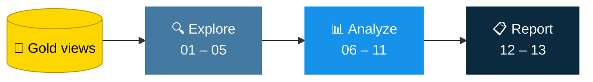

<div align="center">


### 🔎 From analytics-ready views to KPI reports


[](https://www.linkedin.com/in/gist-widdan-anasis-3a0a5b39a/)
[](https://github.com/widdangist999)

</div>

---

## 📑 Table of Contents

- [Overview](#-overview)
- [Project Objectives](#-project-objectives)
- [Tools & Technologies](#-tools--technologies)
- [Data Sources](#-data-sources)
- [Analysis Performed](#-analysis-performed)
- [Repository Structure](#-repository-structure)
- [Key Metrics](#-key-metrics)
- [How to Run](#-how-to-run)
- [Limitations](#-limitations)
- [Related Project](#-related-project)
- [Connect](#-connect)

---

## 🎯 Overview

This project performs **Exploratory Data Analysis (EDA)** and **Advanced Analytics** using **MySQL 8.0**. It analyzes customer, product, and sales transaction data from the **Gold layer** of a data warehouse to explore data characteristics, measure business performance, identify trends, and generate analytical reports.

It builds upon my previous [SQL Data Warehouse project](https://github.com/widdangist999/sql_data_warehouse_project) and demonstrates how SQL can transform structured data into **meaningful business insights**.

---

## 🧭 Project Objectives

- Explore customer, product, and sales transaction data.
- Examine date ranges and calculate key business metrics.
- Analyze sales performance across products, customers, and categories.
- Identify top-performing and low-performing products and customers.
- Analyze changes over time and cumulative sales performance.
- Measure category contributions to overall sales.
- Segment products by cost and customers by purchasing behavior.
- Build customer and product reports containing key performance indicators (KPIs).
- Practice writing structured, reusable, and analytical SQL queries.

---

## 🛠️ Tools & Technologies

| Component | Technology |
|---|---|
| **Database** | MySQL 8.0 |
| **Query Language** | SQL |
| **Database Management Tool** | MySQL Workbench |
| **Version Control** | Git and GitHub |

---

## 📂 Data Sources

The analysis uses the following Gold layer views from the `DataWarehouseProject` database.

| View | Description |
|---|---|
| `gold_dim_customers` | Contains customer dimension data. |
| `gold_dim_products` | Contains product dimension data. |
| `gold_fact_sales` | Contains sales transaction data. |

> The Gold layer views were created as part of my previous SQL Data Warehouse project.

---

## 🔬 Analysis Performed



| # | Analysis | Script |
|:-:|---|---|
| 1 | Data Exploration | `01` – `04` |
| 2 | Magnitude Analysis | `05_magnitude_analysis.sql` |
| 3 | Ranking Analysis | `06_ranking_analysis.sql` |
| 4 | Change Over Time | `07_change_over_time_analysis.sql` |
| 5 | Cumulative Analysis | `08_cumulative_analysis.sql` |
| 6 | Performance Analysis | `09_performance_analysis.sql` |
| 7 | Part-to-Whole Analysis | `10_part_to_whole_analysis.sql` |
| 8 | Data Segmentation | `11_data_segmentation.sql` |
| 9 | Customer Report | `12_report_customers.sql` |
| 10 | Product Report | `13_report_products.sql` |

### 🔍 1. Data Exploration

**Scripts:** `01_database_exploration.sql` – `04_measure_exploration.sql`

Explores the database structure, customer and product dimensions, date ranges, and key business metrics.

- Identifies distinct customer countries.
- Explores product categories, subcategories, and product names.
- Examines the earliest and latest sales transaction dates.
- Calculates date ranges and customer ages.
- Calculates total sales, total quantity sold, average price, total orders, total products, and total customers.

### 📏 2. Magnitude Analysis

**Script:** `05_magnitude_analysis.sql`

Examines the scale of business activity across different dimensions.

- Analyzes customer distribution by country and gender.
- Examines product distribution by category.
- Calculates average product cost by category.
- Aggregates revenue by category and customer.
- Analyzes quantities sold across countries.

### 🏆 3. Ranking Analysis

**Script:** `06_ranking_analysis.sql`

Ranks products and customers using sales and transaction metrics.

- Identifies top-performing products by revenue.
- Identifies products with the lowest sales.
- Compares ranking approaches using `LIMIT` and window functions.
- Ranks customers by revenue and order activity.
- Handles ties in ranking results.

### 📈 4. Change Over Time Analysis

**Script:** `07_change_over_time_analysis.sql`

Analyzes business performance over time.

- Aggregates sales, customer counts, and quantities by year and month.
- Examines monthly sales patterns.
- Formats date values for reporting while preserving chronological ordering.

### ➕ 5. Cumulative Analysis

**Script:** `08_cumulative_analysis.sql`

Examines running totals and cumulative performance.

- Calculates monthly sales and running sales totals.
- Calculates cumulative sales across years.
- Tracks cumulative average price metrics.

### ⚖️ 6. Performance Analysis

**Script:** `09_performance_analysis.sql`

Evaluates product sales performance against historical benchmarks.

- Compares annual product sales with average sales.
- Measures changes relative to previous available product sales periods.
- Calculates absolute and percentage differences using window functions.

### 🥧 7. Part-to-Whole Analysis

**Script:** `10_part_to_whole_analysis.sql`

Measures the contribution of individual categories to total sales.

- Aggregates sales by category.
- Calculates each category's percentage contribution to overall sales.
- Uses window functions to calculate the overall sales denominator.

### 🧩 8. Data Segmentation

**Script:** `11_data_segmentation.sql`

Groups products and customers into analytical segments.

- Segments products according to cost ranges.
- Calculates the number of products in each cost segment.
- Segments customers using purchasing activity, spending, and transaction lifespan.
- Summarizes the number of customers in each segment.

### 👥 9. Customer Report

**Script:** `12_report_customers.sql`

Creates the `gold_report_customers` view to consolidate customer-level metrics.

- Customer identification and age groups.
- Customer segmentation.
- Total orders, sales, and quantity purchased.
- Number of distinct products purchased.
- Last order date and recency.
- Customer purchasing lifespan.
- Average order value and average monthly spending.

### 📦 10. Product Report

**Script:** `13_report_products.sql`

Creates the `gold_report_products` view to consolidate product-level metrics.

- Product name, category, subcategory, and cost.
- Product performance segments based on total sales.
- Total orders, sales, quantity sold, and unique customers.
- Last sale date, recency, and sales lifespan.
- Average selling price.
- Average order revenue and average monthly revenue.

---

## 📁 Repository Structure

```text
sql_data_analiytics_project/
├── scripts/
│   ├── 01_database_exploration.sql
│   ├── 02_dimensions_exploration.sql
│   ├── 03_date_range_exploration.sql
│   ├── 04_measure_exploration.sql
│   ├── 05_magnitude_analysis.sql
│   ├── 06_ranking_analysis.sql
│   ├── 07_change_over_time_analysis.sql
│   ├── 08_cumulative_analysis.sql
│   ├── 09_performance_analysis.sql
│   ├── 10_part_to_whole_analysis.sql
│   ├── 11_data_segmentation.sql
│   ├── 12_report_customers.sql
│   └── 13_report_products.sql
├── results/
│   └── analysis_results.md
└── README.md
```

---

## 📊 Key Metrics

The following metrics summarize the results obtained from the executed SQL queries.

| 💰 Total Sales | 📦 Quantity Sold | 💲 Average Price |
|:---:|:---:|:---:|
| **29,356,250** | **60,423** | **486.0378** |

| 🧾 Total Orders | 🏷️ Total Products | 👥 Total Customers |
|:---:|:---:|:---:|
| **27,659** | **295** | **18,484** |

📅 **Sales transaction date range:** December 29, 2010 to January 28, 2014

> These metrics represent the documented query outputs. The currency unit has not been specified in the dataset documentation.

For additional results and details, see [`results/analysis_results.md`](results/analysis_results.md).

---

## 🚀 How to Run

1. Install **MySQL Server 8.0** and **MySQL Workbench**.
2. Ensure that the `DataWarehouseProject` database and the required Gold layer views are available.
3. Clone or download this repository.
4. Open the SQL scripts in the `scripts/` directory using MySQL Workbench.
5. Execute the scripts against the appropriate database.
6. Review the query outputs and compare them with the documented results.

> **Note:** The scripts query existing Gold layer views. The data warehouse construction and data preparation processes are documented separately in the related project.

---

## ⚠️ Limitations

- The analysis depends on the completeness and accuracy of the existing Gold layer views.
- Product and customer segmentation thresholds are defined by the SQL queries and should be interpreted within the context of the dataset.
- Historical comparisons depend on the available transaction periods for each product.
- Sales values are presented in the dataset's units because the currency has not been specified.
- The results document the analyzed dataset and should not automatically be generalized to other businesses or datasets.

---

## 🔗 Related Project

This project uses the Gold layer views from my previous SQL Data Warehouse project.

<div align="center">

[](https://github.com/widdangist999/sql_data_warehouse_project)

</div>

---

## 🤝 Connect

- 💼 **LinkedIn:** [Gist Widdan Anasis](https://www.linkedin.com/in/gist-widdan-anasis-3a0a5b39a/)
- 🐙 **GitHub:** [widdangist999](https://github.com/widdangist999)

<div align="center">

⭐ *If you find this project useful, a star on the repository is appreciated!*


</div>
